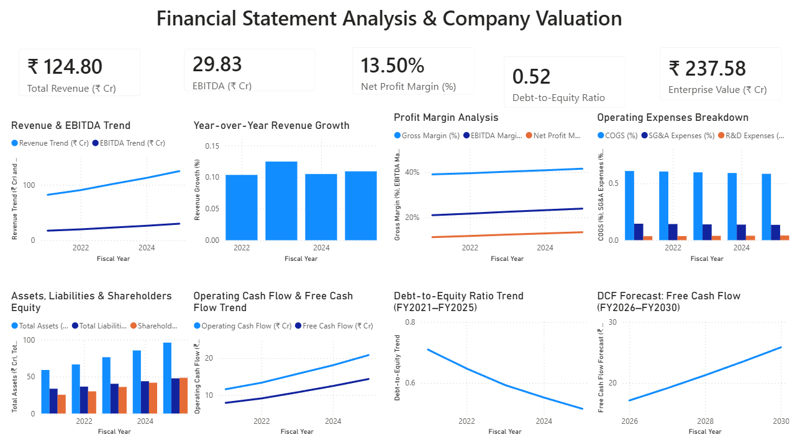

# Financial Statement Analysis & Company Valuation

An end-to-end financial analytics project using **SQL, Python, Excel, DAX, and Power BI** to analyze financial performance, assess profitability and leverage, forecast free cash flow, and estimate enterprise value using the Discounted Cash Flow (DCF) method.

> **Disclaimer:** This project uses synthetic financial data for a fictional company. Results are illustrative and are not investment advice.

## Project Overview

This project examines five years of historical financial statements (FY2021–FY2025) and forecasts free cash flow for FY2026–FY2030. It combines SQL-based analysis, Python financial calculations, and an interactive Power BI dashboard.

## Objectives

- Analyze revenue growth and EBITDA performance.
- Evaluate gross margin, EBITDA margin, and net profit margin.
- Assess operating expenses and financial structure.
- Analyze assets, liabilities, shareholders' equity, and debt.
- Examine operating cash flow and free cash flow.
- Estimate enterprise value using a DCF model.

## Tools & Technologies

| Tool | Purpose |
|---|---|
| Excel | Financial data preparation |
| MySQL | Data management and analytical queries |
| Python | Financial ratios and data-quality checks |
| Pandas & NumPy | Data manipulation and calculations |
| Power BI | Interactive dashboard |
| DAX | KPI measures and financial calculations |

## Power BI Dashboard

The dashboard contains five KPI cards and eight visualizations.

### Key Performance Indicators

- Total Revenue (₹ Cr)
- EBITDA (₹ Cr)
- Net Profit Margin (%)
- Debt-to-Equity Ratio
- Enterprise Value (₹ Cr)

### Visualizations

1. Revenue & EBITDA Trend
2. Year-over-Year Revenue Growth
3. Profit Margin Analysis
4. Operating Expenses Breakdown
5. Assets, Liabilities & Shareholders' Equity
6. Operating Cash Flow & Free Cash Flow Trend
7. Debt-to-Equity Ratio Trend (FY2021–FY2025)
8. DCF Forecast: Free Cash Flow (FY2026–FY2030)

### Dashboard Screenshot



## Dataset

The dataset includes synthetic financial information for FY2021–FY2025, forecast assumptions, and valuation inputs.

Key variables include revenue, COGS, gross profit, EBITDA, net income, SG&A expenses, R&D expenses, total assets, total liabilities, shareholders' equity, long-term debt, operating cash flow, and free cash flow.

All financial amounts are denominated in Indian Rupees (INR).

## Methodology

1. **Data preparation:** Prepared historical financial statements and forecast assumptions in Excel.
2. **SQL analysis:** Structured financial data and performed financial analysis queries.
3. **Python analysis:** Calculated growth metrics, profitability margins, leverage ratios, and data-quality checks.
4. **Power BI:** Built an interactive dashboard using DAX measures.
5. **DCF valuation:** Used forecast free cash flow, WACC, and terminal growth assumptions to estimate enterprise value.

## Illustrative Findings

Based on the synthetic dataset and current model outputs:

| Metric | Result |
|---|---:|
| FY2025 Revenue | ₹124.80 Cr |
| FY2025 EBITDA | ₹29.83 Cr |
| FY2025 Net Profit Margin | 13.50% |
| FY2025 Debt-to-Equity Ratio | 0.52x |
| Illustrative Enterprise Value | ₹237.58 Cr |

These values are illustrative and depend on the data and assumptions used in the model. They do not represent the performance or valuation of an actual company.

## DCF Valuation

The Discounted Cash Flow method estimates enterprise value by discounting forecast free cash flow and terminal value to the present.

\[
EV = \sum_{t=1}^{n}\frac{FCFF_t}{(1+WACC)^t}
+\frac{TV_n}{(1+WACC)^n}
\]

Where:

- **EV:** Enterprise Value
- **FCFF:** Free Cash Flow to the Firm
- **WACC:** Weighted Average Cost of Capital
- **TV:** Terminal Value

The estimate is sensitive to assumptions such as WACC, terminal growth, and forecast cash flows.

## Run the Python Analysis

### Requirements

- Python 3.9 or later
- pandas
- NumPy
- openpyxl

Install the required libraries:

```bash
pip install pandas numpy openpyxl
```

Place the cleaned Excel workbook in the same directory as `financial_statement_analysis.py`, then run:

```bash
python financial_statement_analysis.py
```

The script produces an Excel results workbook containing financial analysis outputs and data-quality checks. DCF calculations are produced when the necessary forecast and valuation inputs are available.

## Run the SQL Analysis

1. Open MySQL Workbench.
2. Open the SQL script included in this repository.
3. Execute the script to create the database, load the historical data, and run the analysis queries.
4. Review the results for financial performance insights.

## Repository Contents

- `README.md` — Project documentation
- `Financial_Statement_Analysis_Company_Valuation_Cleaned.xlsx` — Cleaned source dataset
- `Financial_Statement_Analysis_Company_Valuation_Python_Results.xlsx` — Python analysis results
- `financial_statement_analysis.py` — Python source code
- `Financial_Statement_Analysis_Company_Valuation.sql` — SQL analysis script
- `Financial_Statement_Analysis_Company_Valuation.pbix` — Power BI dashboard file
- `Financial_Statement_Analysis_Company_Valuation.png` — Dashboard screenshot

## Future Improvements

- Add a DCF sensitivity heatmap to Power BI.
- Incorporate optimistic, base-case, and pessimistic scenarios.
- Validate calculations across SQL, Python, and Power BI.
- Extend the analysis to multiple companies using publicly reported financial statements.

## Skills Demonstrated

Financial Statement Analysis · Financial Modeling · DCF Valuation · SQL · Python · Pandas · NumPy · Excel · Power BI · DAX · Data Cleaning · Data Validation · KPI Reporting · Business Intelligence

---

**Author:** Tanvi Kamat

**Project Type:** Financial Analytics & Business Intelligence Portfolio Project
